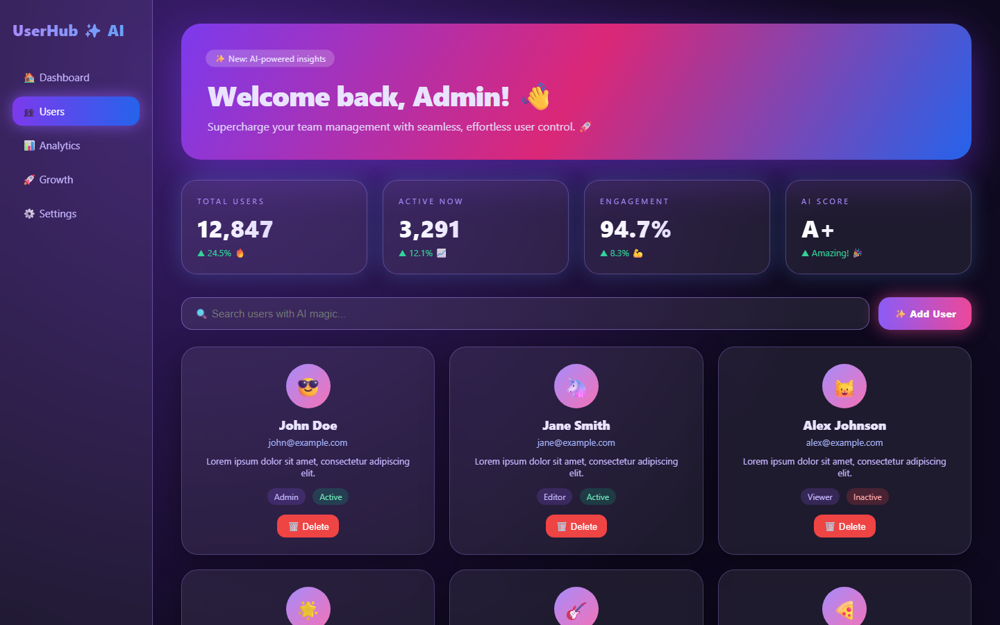
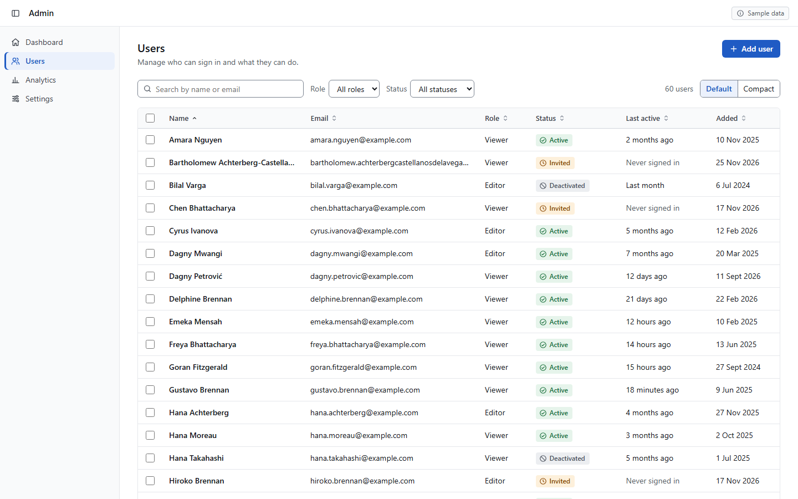

# enterprise-ui example: an admin users page

The request: "build an admin page to manage users, make it look professional, not like AI made it. Here is what we have now: before.html"

[before.html](before.html) was written by hand to show common AI-slop patterns. [after.html](after.html) was produced by Claude Opus 5.5 following [skills/enterprise-ui/SKILL.md](../../skills/enterprise-ui/SKILL.md) in Build mode, and is shown unedited. Its delivery notes, with assumptions and what was and was not checked, are in [after-notes.md](after-notes.md).

| Before | After |
| --- | --- |
|  |  |

Both screenshots are 1440 by 900 px.

## Try it

Open them live: [before.html](https://shashikantdev3.github.io/wellasked/examples/enterprise-ui/before.html) and [after.html](https://shashikantdev3.github.io/wellasked/examples/enterprise-ui/after.html). You can also download both files and open them locally; after.html loads nothing from the network.

Each state has its own link: [empty](https://shashikantdev3.github.io/wellasked/examples/enterprise-ui/after.html?state=empty), [loading](https://shashikantdev3.github.io/wellasked/examples/enterprise-ui/after.html?state=loading), [error](https://shashikantdev3.github.io/wellasked/examples/enterprise-ui/after.html?state=error), [no permission](https://shashikantdev3.github.io/wellasked/examples/enterprise-ui/after.html?state=noaccess). Search for something that does not exist to see the no-results state.
